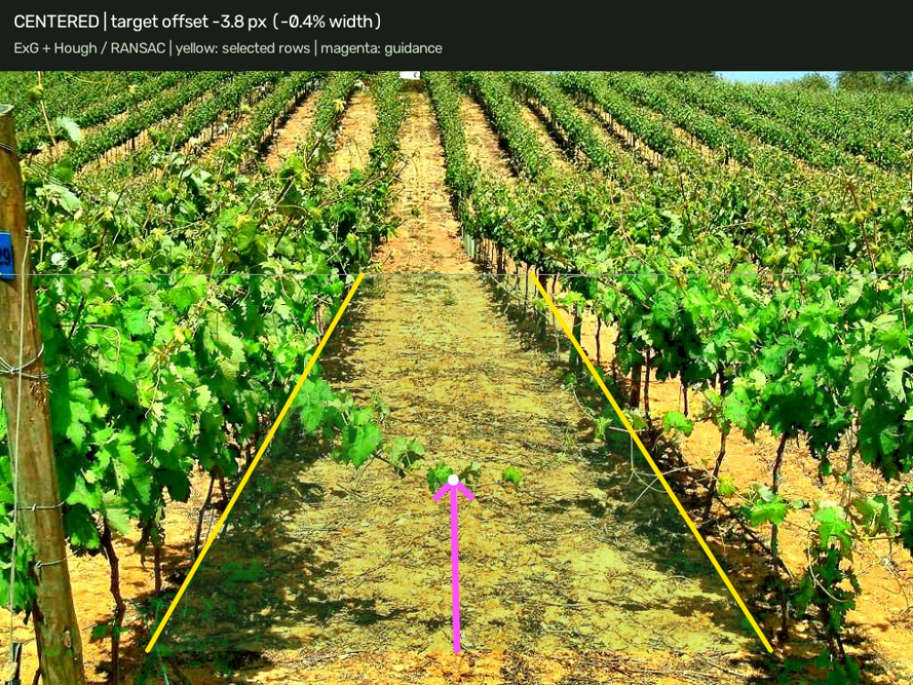
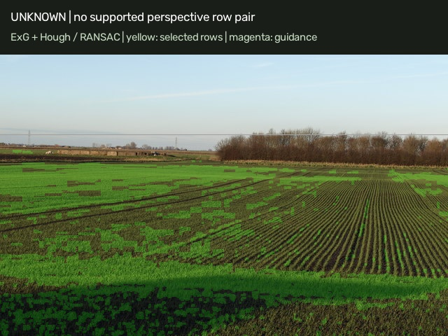
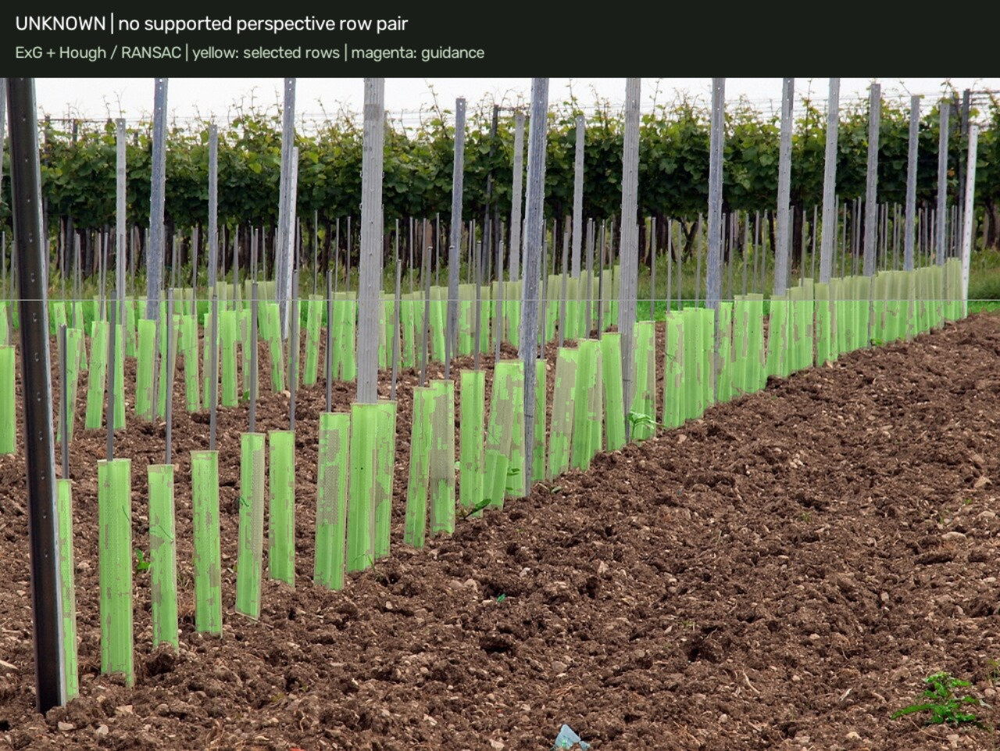

# Crop rows to a steering hint

A small, runnable **classic computer-vision** conversation piece for Burro: take an outdoor vineyard/field photo, mask vegetation, fit crop-row boundaries, and draw a center guidance arrow. No model weights, API keys, or network access at runtime.

Built by **Muhammad Abdulrehman**, a Drexel CS student about a mile from Burro's N 7th St Philadelphia HQ. In Drexel's McDonald Lab, I work on robot-arm vision with YOLO / RF-DETR and Intel RealSense to locate and transfer powder samples using an xArm 6. This is a quick exploration of a different robotics problem: how far can a transparent, lightweight vision baseline get toward following a crop corridor outdoors?

Independent application demo; not a Burro product or a reproduction of its autonomy system.

## Run

Python 3.10+ (tested on Windows with Python 3.13.1). From this directory:

```powershell
python -m venv .venv
.\.venv\Scripts\python.exe -m pip install -r requirements.txt
.\.venv\Scripts\python.exe row_detect.py samples/vineyard_portugal.jpg
```

Or, with dependencies installed in your active Python environment:

```sh
python row_detect.py field.jpg
# Writes field_annotated.jpg alongside the input and prints one JSON record.
python row_detect.py field.jpg -o result.jpg --mask-output vegetation.png
python row_detect.py field.jpg --roi-top 0.48 --deadband 0.04
python -m unittest -v
```

`--roi-top` selects the top of the ground region as a fraction of image height; default 0.40. `--deadband` is the centered tolerance as a fraction of image width; default 0.04. All samples below use defaults. Exit codes: **0** supported row pair, **2** unknown (annotated image still written), **1** image/I/O error. Invalid arguments also use argparse's exit code 2, without an output image. Input and output paths must differ.

## What the script actually does

1. Resize to at most 1000 pixels wide for bounded computation; preserve the original output dimensions.
2. Compute normalized excess green, `ExG = (2G - R - B) / (R + G + B)`. Apply Otsu's threshold within the ground ROI plus a positive-green floor and channel-ratio checks. A 3x3 opening removes speckles.
3. Use Canny on the vegetation mask and probabilistic Hough to seed line hypotheses. Locally fit `x = a*y + b` with deterministic RANSAC, then least squares on the inliers. Reject short, weakly supported, and duplicate lines. This detects vegetation boundaries, rather than identifying individual plants.
4. Select two supported boundaries that bracket the image center near the bottom, narrow toward the distance, and intersect at a plausible vanishing point. Rank by edge support and proximity to the optical axis. The lines are fitted in perspective image coordinates; there is no assumed metric homography or camera calibration.
5. At **70% of image height**, take the pair's midpoint. The signed target offset is `target_x - image_width/2`, in original-image pixels. Negative means **steer left**, positive means **steer right**, and within +/-4% of image width means **centered**. This is an image-space heading hint, not lateral displacement in meters or a steering-wheel angle.

Yellow lines mark the selected crop boundaries; the magenta arrow points from the assumed robot/image center toward the corridor midpoint. Green tint shows vegetation-mask pixels; the gray line marks the ROI top. If the geometric checks fail, the overlay explicitly says **UNKNOWN** and the offset is `null`. Candidate counts are diagnostics, not confidence probabilities.

## Real runs, including failures

The committed JPEGs below were produced by running this script on the included photos, with no manually placed lines or per-image coordinates.

| Sample | Result with default settings | Target offset |
| --- | --- | --- |
| Portugal vineyard | centered; central aisle boundaries found | -3.8 px (-0.37% width) |
| Cambridgeshire field | unknown; no supported row candidates | null |
| Young Austrian vines | unknown; candidates do not form a valid corridor | null |

**Detected vineyard corridor**



**Failure case: dense rows, shadow, and a high horizon**



**Failure case: oblique view and pale protective sleeves**



The small behavioral test suite checks left / centered / right on synthetic converging vegetation rows, blank and non-green scenes, and an insufficient single row. Synthetic checks verify geometry and sign conventions; they are not a field-accuracy benchmark. Horizontal translation checks on the real Portugal photo also produced the expected left/right hints.

## Limits and next experiments

This baseline works best looking forward into a fairly straight aisle with green crops and contrasting bare soil. The field sample exposes a real weakness: thin rows and shadows do not survive this mask and support threshold well. The young-vine sample is an oblique view rather than a traversable forward corridor. Green weeds, grass between rows, occlusion, curved rows, glare, brown crops, camera roll, and multiple plausible aisles can cause missed or incorrect fits. A geometrically accepted pair can still be wrong. There is no obstacle detection, depth, temporal tracking, calibrated confidence, or robot control here.

With robot footage, I would label aisle boundaries across lighting conditions, measure centerline error and false-guidance rate, add temporal consistency and camera calibration, and use RealSense/depth or learned segmentation where color breaks down. On hardware, uncertain perception should feed a stop/recovery policy rather than an unconditional steering command.

## Sample sources and reuse

The source photographs are freely licensed; they are not mine. Original filenames were shortened locally. Portugal and Cambridgeshire inputs retain their downloaded JPEGs; the Austrian input is Wikimedia's 1280-pixel thumbnail. The annotated versions add the detector overlays and inherit the respective photo license. Attribution and license links apply to both the input and annotated image in each row.

| Local input / annotated counterpart | Photographer and source | License |
| --- | --- | --- |
| `vineyard_portugal.jpg` / `vineyard_portugal_annotated.jpg` | Ronald Saunders, [Rows of vines, Quinta do Miradouro, Portugal](https://commons.wikimedia.org/wiki/File:Flickr_-_ronsaunders47_-_rows_of_vines.jpg), 6 May 2005 | [CC BY-SA 2.0](https://creativecommons.org/licenses/by-sa/2.0/) |
| `crop_rows.jpg` / `crop_rows_annotated.jpg` | Ian Simons, [Crop Rows, Cambridgeshire / Geograph 656084](https://commons.wikimedia.org/wiki/File:Crop_Rows_-_geograph.org.uk_-_656084.jpg), 12 January 2008 | [CC BY-SA 2.0](https://creativecommons.org/licenses/by-sa/2.0/) |
| `young_vines.jpg` / `young_vines_annotated.jpg` | Roberto Verzo, [Rows of young grape vines with protective shell, Austria](https://commons.wikimedia.org/wiki/File:Rows_of_young_grape_vines_with_protective_shell.jpg), 16 June 2010 | [CC BY 2.0](https://creativecommons.org/licenses/by/2.0/) |

Code is MIT licensed; sample-photo rights remain with their photographers under the licenses above.
